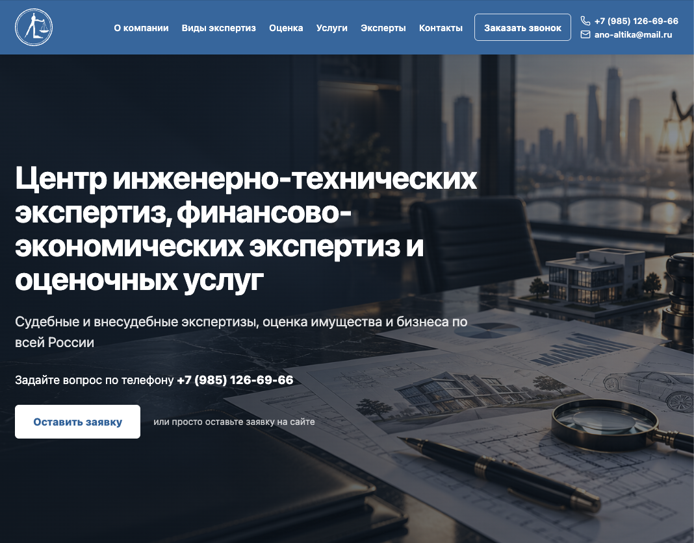
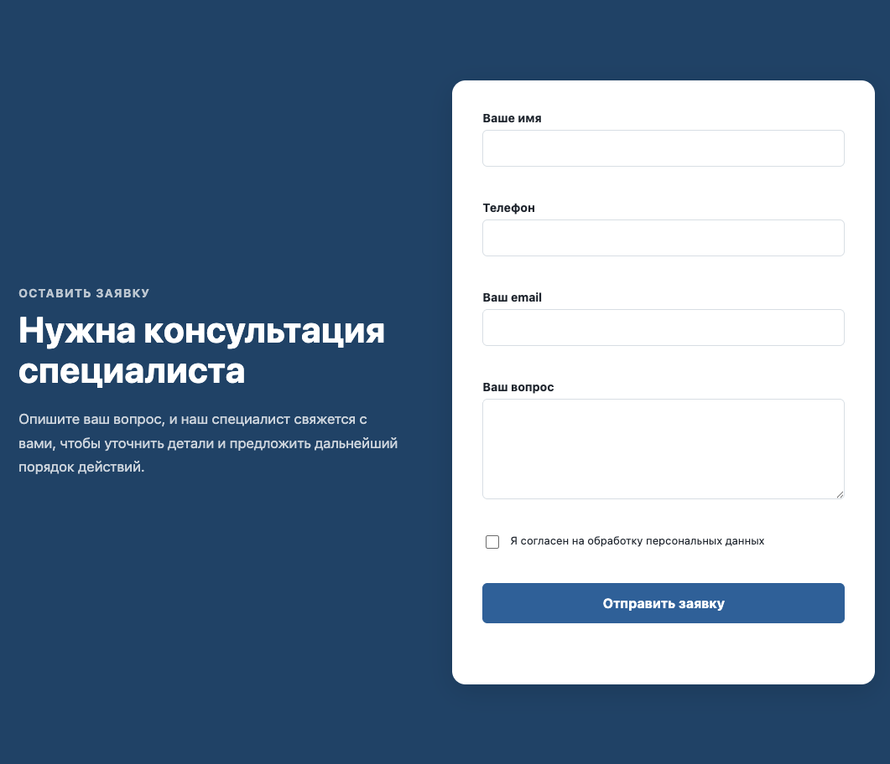
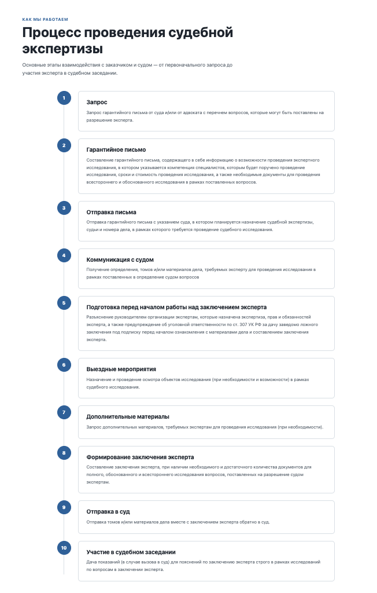
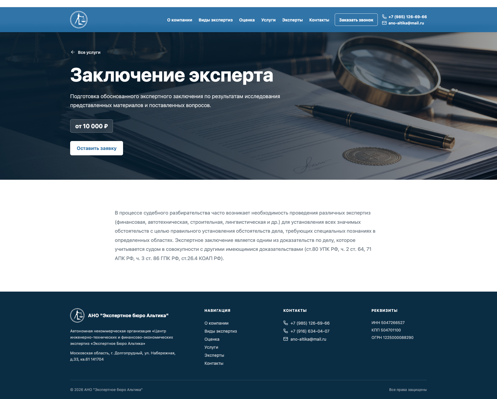
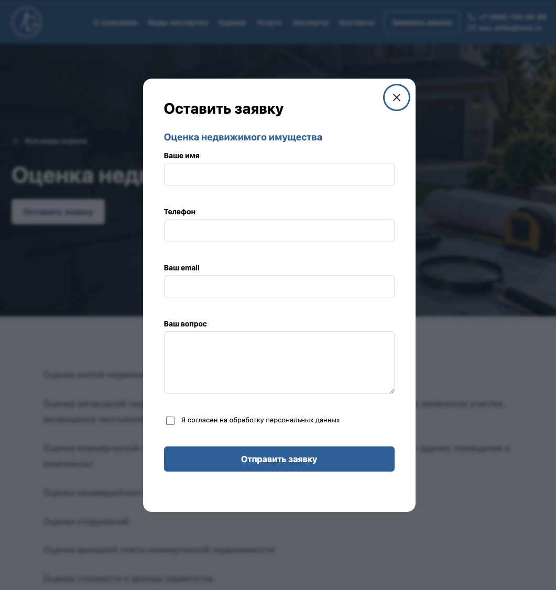

# Экспертное бюро «Альтика»

Коммерческий full-stack проект для сайта экспертно-оценочной компании.

Проект разработан как управляемый корпоративный сайт с отдельными страницами экспертиз, видов оценки, услуг и специалистов, административной панелью для управления контентом, системой заявок, email- и Telegram-уведомлениями, техническим SEO и production-развёртыванием на REG.RU.

Frontend построен на **React + Vite**, backend — на **Django + Django REST Framework**, данные хранятся в **MySQL**.

> Проект разрабатывался для реальной организации и проходит этап согласования контента перед переносом на основной домен.

## Скриншоты

### Главная страница



### Форма консультации



### Процесс проведения судебной экспертизы



### Страница услуги



### Модальная форма заявки



## Demo

Preview:

**https://preview-test.site**

Preview-версия предназначена для согласования проекта с заказчиком и закрыта от индексации поисковыми системами.

В разделах специалистов и документов компании могут использоваться тестовые данные до предоставления финального контента заказчиком.

Production-домен:

**https://altika-expert.ru**

## Моя роль в проекте

Проект реализован мной как full-stack разработчиком — от проектирования структуры данных и пользовательского интерфейса до настройки production-окружения.

В рамках проекта я:

- спроектировал структуру React-приложения и компонентную архитектуру;
- реализовал адаптивный интерфейс и внутренние страницы;
- спроектировал модели Django и связи между сущностями;
- разработал REST API на Django REST Framework;
- настроил Django Admin как CMS для заказчика;
- реализовал формы заявок и серверную валидацию;
- реализовал сохранение заявок в MySQL;
- подключил SMTP-уведомления и Telegram Bot API;
- реализовал загрузку и отображение media-файлов;
- разработал гибридный SEO-механизм Django + React;
- реализовал sitemap, robots, canonical, Open Graph и JSON-LD;
- подготовил preview-режим, закрытый от индексации;
- настроил production build React/Vite внутри Django;
- развернул проект на REG.RU через Passenger;
- настроил MySQL, SSL, static/media, redirects и production deployment;
- диагностировал и устранял ошибки, возникавшие уже в production-like окружении.

## Основные возможности

- адаптивный интерфейс на React;
- отдельные страницы экспертиз, услуг, оценки и специалистов;
- REST API на Django REST Framework;
- управление контентом через Django Admin;
- загрузка изображений и документов;
- MySQL в качестве основной базы данных;
- формы заявок нескольких типов;
- сохранение каждой заявки в базе данных;
- уведомления о новых заявках по email;
- уведомления через Telegram Bot API;
- защита формы от частых запросов;
- динамическое SEO для внутренних страниц;
- `sitemap.xml`;
- `robots.txt`;
- canonical URL;
- Open Graph metadata;
- JSON-LD structured data;
- корректные HTTP 404;
- отдельный preview-режим с `noindex`;
- production-сборка React через Vite;
- deployment на виртуальный хостинг REG.RU;
- HTTPS и canonical redirect с `www`.

## Технологический стек

### Frontend

```text
React
JavaScript
Vite
React Router
Axios
SCSS
Lucide React
Leaflet / OpenStreetMap
```

### Backend

```text
Python 3.13
Django 6.0
Django REST Framework
Django Admin
mysqlclient
python-dotenv
```

### Database

```text
MySQL 8
```

### Интеграции

```text
SMTP
Telegram Bot API
```

### Infrastructure

```text
Git
GitHub
Passenger
REG.RU
HTTPS
```

## Документация
- [Журнал разработки](docs/DEVLOG.md)

## Архитектура

```text
                    ┌──────────────────┐
                    │   Django Admin   │
                    └────────┬─────────┘
                             │
                             ▼
                        ┌─────────┐
                        │  MySQL  │
                        └────┬────┘
                             │
                             ▼
┌────────────┐        ┌───────────────┐
│   React    │◄──────►│ Django / DRF  │
│   Vite     │  REST  │               │
└─────┬──────┘        └───────┬───────┘
      │                       │
      │                       ├── SMTP
      │                       ├── Telegram API
      │                       ├── SEO
      │                       ├── Sitemap
      │                       └── Media
      ▼
┌────────────┐
│   Client   │
└────────────┘
```

React отвечает за пользовательский интерфейс, SPA-навигацию, формы, модальные окна и взаимодействие с REST API.

Django отвечает за:

```text
REST API
работу с MySQL
Django Admin
хранение заявок
уведомления
media
первичные SEO metadata
sitemap
robots
HTTP routing
```

## Структура проекта

```text
altika-expert/
│
├── backend/
│   ├── config/
│   │   ├── settings.py
│   │   ├── urls.py
│   │   ├── frontend.py
│   │   └── wsgi.py
│   │
│   ├── company/
│   ├── services/
│   ├── experts/
│   ├── applications/
│   │
│   ├── templates/
│   │   └── frontend/
│   │       └── index.html
│   │
│   ├── static/
│   ├── staticfiles/
│   ├── media/
│   │
│   ├── manage.py
│   └── requirements.txt
│
├── frontend/
│   ├── src/
│   │   ├── api/
│   │   ├── assets/
│   │   ├── components/
│   │   ├── layouts/
│   │   ├── pages/
│   │   ├── sections/
│   │   ├── styles/
│   │   ├── utils/
│   │   ├── App.jsx
│   │   └── main.jsx
│   │
│   ├── package.json
│   └── vite.config.js
│
├── docs/
│   └── screenshots/
├── .env.example
├── .gitignore
└── README.md
```

## Backend

Backend разделён на несколько Django-приложений.

### `company`

Основная информация о компании и контент главной страницы.

Содержит сущности:

```text
Company
CompanyAdvantage
Expertise
ValuationType
ProcessStep
UseCase
CompanyDocument
SiteSettings
```

Через Django Admin можно изменять значительную часть контента сайта без изменения исходного кода.

### `services`

Дополнительные услуги компании.

Каждая услуга имеет отдельный `slug`, краткое и подробное описание, изображение, SEO-данные и собственную страницу.

### `experts`

Информация о специалистах.

```text
Expert
 ├── ManyToMany → Position
 ├── ManyToMany → Specialization
 └── OneToMany  → ExpertDocument
```

Для специалиста могут храниться:

```text
ФИО
фотография
должности
специализации
образование
квалификация
опыт
биография
дипломы
сертификаты
```

### `applications`

Приём пользовательских заявок.

Поддерживаются разные типы обращений:

```text
callback
general
expertise
valuation
service
```

Схема обработки:

```text
React form
    ↓
POST /api/applications/
    ↓
DRF validation
    ↓
MySQL
    ↓
┌─────────────┬──────────────┐
│             │              │
▼             ▼              ▼
Email       Telegram      Django Admin
```

Сначала заявка сохраняется в базе данных, и только после этого выполняется отправка уведомлений.

Такой подход позволяет не потерять обращение пользователя при временной ошибке SMTP или Telegram API.

## Frontend

Frontend реализован как React SPA.

Основные маршруты:

```text
/
/expertises/:slug
/valuation/:slug
/services/:slug
/experts/:slug
```

### Компонентная структура

Переиспользуемые UI-компоненты находятся в:

```text
frontend/src/components/
```

Например:

```text
Container
Header
Footer
Modal
ApplicationForm
CallbackForm
ExpertiseCard
ValuationCard
ServiceCard
ExpertCard
DocumentCard
ExpertDocumentCard
```

Крупные смысловые блоки главной страницы расположены отдельно:

```text
frontend/src/sections/
```

Например:

```text
Hero
About
Expertises
Valuation
Services
Experts
UseCases
Documents
Contacts
```

## API

API-логика вынесена из визуальных компонентов в отдельный слой:

```text
frontend/src/api/
```

Примеры:

```text
getCompany()
getExpertises()
getExpertiseItem()
getValuationTypes()
getValuationItem()
getServices()
getServiceItem()
getExperts()
getExpertItem()
getProcessSteps()
getUseCases()
getCompanyDocuments()
getSiteSettings()
sendApplication()
sendCallback()
```

Основные endpoint:

```text
GET  /api/company/
GET  /api/company/advantages/

GET  /api/company/expertises/
GET  /api/company/expertises/:slug/

GET  /api/company/valuation/
GET  /api/company/valuation/:slug/

GET  /api/company/processes/:type/
GET  /api/company/use-cases/
GET  /api/company/documents/
GET  /api/company/settings/

GET  /api/services/
GET  /api/services/:slug/

GET  /api/experts/
GET  /api/experts/:slug/

POST /api/applications/
```

## Управление контентом

Через Django Admin можно управлять:

```text
данными компании
контактами
Hero-блоком
изображениями
экспертизами
оценочными услугами
дополнительными услугами
экспертами
документами
преимуществами
этапами работы
SEO metadata
порядком отображения элементов
видимостью отдельных разделов
```

После изменения контента через Admin frontend rebuild не требуется.

## SEO

Проект использует гибридный механизм SEO.

Django формирует metadata ещё до запуска React:

```html
<title>
<meta name="description">
<meta name="robots">
<link rel="canonical">

<meta property="og:title">
<meta property="og:description">
<meta property="og:url">
<meta property="og:image">
```

Это позволяет поисковому роботу получить информацию о странице непосредственно в первоначальном HTTP response.

После загрузки React компонент `PageSeo` поддерживает metadata в актуальном состоянии при SPA-навигации.

Также реализованы:

```text
sitemap.xml
robots.txt
canonical URL
Open Graph
HTTP 404
JSON-LD
```

Structured Data используется для сущностей:

```text
Organization
Service
Person
```

## Preview mode

Для согласования проекта используется staging:

```text
preview-test.site
```

На нём включён:

```env
PREVIEW_MODE=True
```

В результате сайт получает:

```html
<meta name="robots" content="noindex, nofollow">
```

а `robots.txt` запрещает индексацию:

```text
User-agent: *
Disallow: /
```

Это позволяет показывать production-like версию заказчику до релиза и не создавать дубликат основного сайта в поисковой выдаче.

## Development

### Backend

```bash
cd backend

python3 -m venv .venv
source .venv/bin/activate

pip install -r requirements.txt

cp .env.example .env

python manage.py migrate
python manage.py createsuperuser
python manage.py runserver
```

Backend:

```text
http://127.0.0.1:8000
```

Admin:

```text
http://127.0.0.1:8000/admin/
```

### Frontend

В отдельном терминале:

```bash
cd frontend
npm install
npm run dev
```

Vite:

```text
http://localhost:5173
```

## Environment variables

Пример структуры `.env`:

```env
SECRET_KEY=
DEBUG=True
PREVIEW_MODE=False

DB_NAME=
DB_USER=
DB_PASSWORD=
DB_HOST=localhost
DB_PORT=3306

DEFAULT_FROM_EMAIL=
APPLICATION_NOTIFICATION_EMAIL=

SMTP_HOST=
SMTP_PORT=
SMTP_USER=
SMTP_PASSWORD=
SMTP_USE_TLS=True
SMTP_USE_SSL=False

TELEGRAM_BOT_TOKEN=
TELEGRAM_CHAT_ID=

SITE_URL=http://127.0.0.1:8000
VITE_DEV_SERVER_URL=http://127.0.0.1:5173
```

Настоящие credentials в репозитории не хранятся.

## Production build

Frontend production build создаётся локально:

```bash
cd frontend
npm run build
```

Результат интегрируется в Django static:

```text
backend/static/frontend/build/
```

Vite создаёт manifest:

```text
.vite/manifest.json
```

Django читает manifest и автоматически подключает актуальные hashed JS/CSS assets.

## Deployment

Проект размещён на REG.RU и запускается через Passenger.

Общая схема обновления:

```bash
git pull

cd backend

../.venv/bin/python manage.py migrate
../.venv/bin/python manage.py collectstatic --noinput
../.venv/bin/python manage.py check

cd ..

touch .restart-app
```

Если изменяется frontend, production build предварительно создаётся локально и коммитится в репозиторий.

## Engineering decisions

### Почему Django Admin

Контент сайта должен изменяться заказчиком без необходимости обращаться к разработчику для каждой текстовой или графической правки.

### Почему заявки сначала сохраняются в MySQL

SMTP и Telegram являются внешними сервисами и могут временно быть недоступны.

Поэтому:

```text
заявка
↓
database
↓
notifications
```

Сбой внешней интеграции не должен приводить к потере обращения.

### Почему React + Django initial HTML

React используется для интерактивного UI и SPA-навигации, а Django формирует SEO metadata уже в первоначальном HTTP response.

```text
Django
↓
HTML + SEO
↓
React
↓
SPA navigation
```

### Почему используется Preview Mode

До согласования сайта поисковые системы не должны индексировать staging-домен.

При этом заказчику нужен полноценный production-like сайт с:

```text
DEBUG=False
HTTPS
MySQL
production build
real forms and notifications
```

Поэтому staging функционально близок к production, но закрыт от поисковой индексации.

## Некоторые проблемы, решённые в процессе разработки

В процессе разработки и deployment были решены реальные production-задачи:

```text
совместимость Django и версии MySQL на shared hosting
настройка mysqlclient
подключение MySQL через Unix socket
Django ORM / prefetch_related
nested DRF serializers
throttling форм
SMTP configuration
Telegram API integration
Passenger configuration на REG.RU
SPA routing
Vite hashed assets
Django collectstatic
MIME errors после frontend deployment
www → canonical domain redirect
SSL
server-side SEO
конфликт server SEO и React metadata
preview noindex
динамический canonical
настоящий HTTP 404 для SPA
sitemap и structured data
```

Подробное описание архитектурных решений и проблем разработки планируется вынести в отдельный `docs/DEVLOG.md`.

## Статус проекта

Основная функциональность проекта завершена.

Текущий этап:

```text
согласование контента с заказчиком
замена оставшихся тестовых данных
production migration
финальная SEO-проверка
```

## Автор

**Михаил Авраменко**

Frontend / Full-stack developer

Основные технологии:

```text
JavaScript
React
Redux
Django
Django REST Framework
MySQL
SCSS
Vite
Git
```

GitHub:

https://github.com/avramenkomy

Portfolio:

https://www.dev-mike.ru
